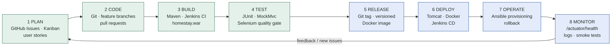
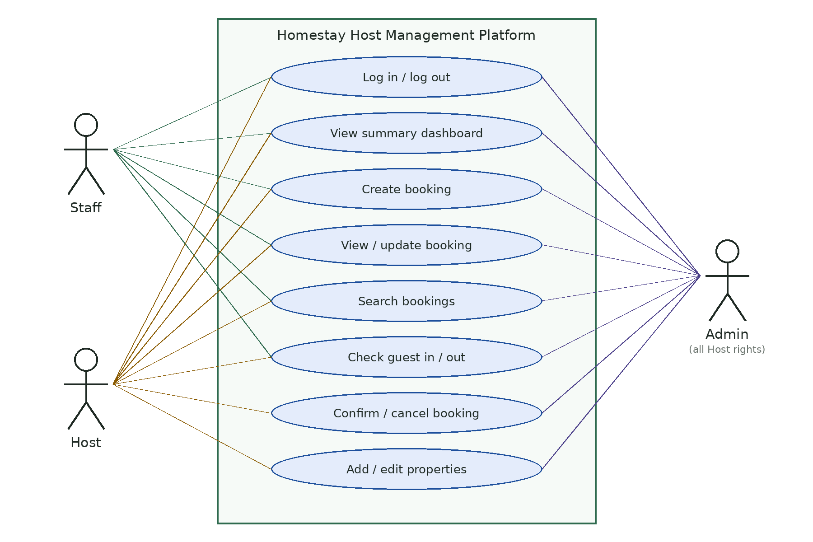
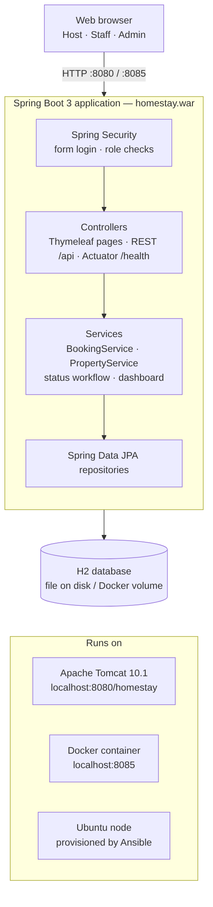
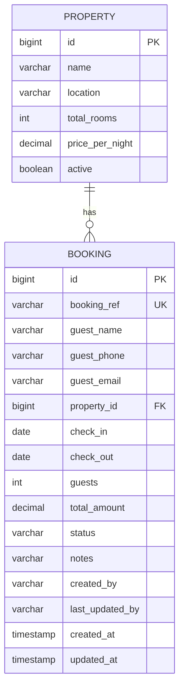
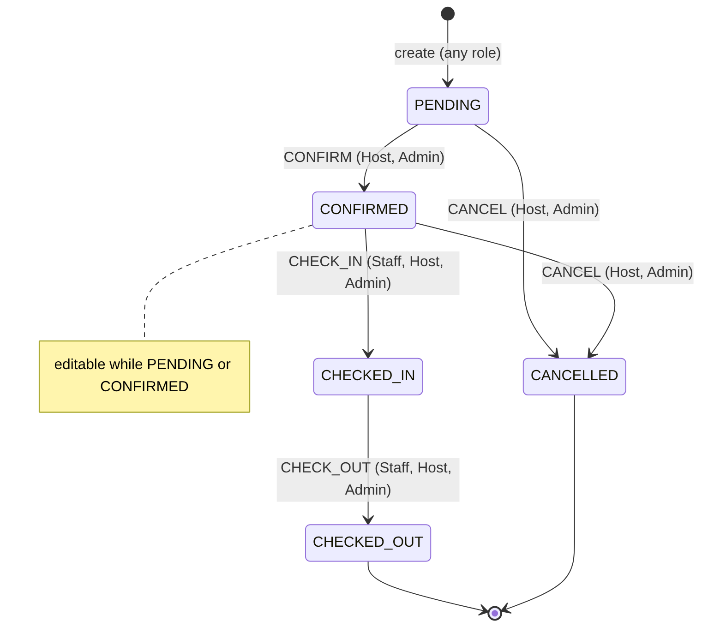
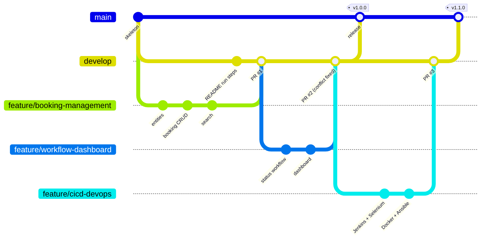
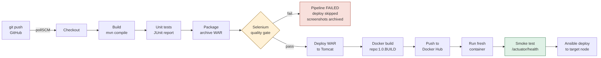

# Containerized Homestay Host Management Platform
## DevOps Mini Project Report

| | |
|---|---|
| **Student** | Shruti Tambade |
| **Roll No.** | 23102A0072 |
| **Class** | BE Computer Engineering – Division A (Sem VII) |
| **Academic Year** | 2026-27, ODD Semester |
| **Subject** | DevOps |
| **Repository** | `https://github.com/<your-user>/homestay-host-platform` |

---

## Abstract

Small homestay owners manage bookings over WhatsApp, phone calls and paper registers, which leads to double bookings, missed check-ins and no clear view of the business. This project delivers a **Homestay Host Management Platform**: a Spring Boot web application where hosts and staff create, view, update and search bookings, move them through a **role-based status workflow**, and monitor a **summary dashboard**. The application is developed and operated with a complete DevOps toolchain. **Git/GitHub** provides branching, pull requests and tagged releases. **Jenkins** runs a declarative pipeline that builds with **Maven**, runs unit tests and a **Selenium** UI quality gate, and deploys to **Apache Tomcat**. The pipeline then packages a versioned **Docker** image, publishes it to Docker Hub and replaces the running container. **Ansible** provisions a clean Ubuntu node, deploys the container idempotently, verifies health and rolls back automatically on failure.

---

## 1. Introduction

### 1.1 Problem statement
Homestay hosts lack a simple, shared system to record bookings, control who may confirm or check in a guest, find past stays and see occupancy and revenue. Software updates are manual and risky. (Details: `docs/01-problem-definition.md`.)

### 1.2 Objectives
1. Web MVP: create / view / update / search bookings and properties.
2. Role-based workflow (Host, Staff, Admin) and summary dashboard.
3. Version control with feature branches, PRs, conflict resolution and tags.
4. CI/CD with Jenkins pipeline as code; deployment to Tomcat.
5. Automated Selenium testing as a deployment gate.
6. Containerization with versioned Docker images and automated container deployment.
7. Configuration management and provisioning with Ansible, with idempotency and rollback.

### 1.3 Scope
In scope: the 15 MVP items in `docs/01-problem-definition.md` §9. Out of scope: payments, guest portal, notifications, multi-tenant SaaS.

---

## 2. Agile planning

- 15 user stories (54 points) with acceptance criteria, 5 one-week sprints, a GitHub Projects Kanban board and a Definition of Done (`docs/02-agile-plan.md`).
- The DevOps lifecycle maps every phase to a tool:

---

## 3. Requirements and design

### 3.1 Functional requirements (summary)
Login with roles · property management · booking create/view/update with validation · automatic reference and amount · search by text/status/property · workflow transitions with role checks · dashboard · health/version/JSON API. (Full SRS: `docs/03-requirements-architecture.md`.)

### 3.2 Use cases

### 3.3 Architecture
A layered Spring Boot monolith (security → controllers → services → repositories → H2), packaged as one WAR that runs on Tomcat 10.1 or in Docker.

### 3.4 Data model and workflow

| Action | From → To | Allowed roles |
|---|---|---|
| Confirm | Pending → Confirmed | Host, Admin |
| Check in | Confirmed → Checked in | Staff, Host, Admin |
| Check out | Checked in → Checked out | Staff, Host, Admin |
| Cancel | Pending/Confirmed → Cancelled | Host, Admin |

### 3.5 Technology stack
Java 17 · Spring Boot 3.3 (Web, Security, Data JPA, Validation, Actuator) · Thymeleaf · H2 · Maven 3.9 · Tomcat 10.1 · JUnit 5 / MockMvc / Selenium 4 · Git/GitHub · Jenkins · Docker / Docker Hub · Ansible (`community.docker`).

---

## 4. Implementation

### 4.1 Application modules

| Module | Key classes / files | Function |
|---|---|---|
| Security | `SecurityConfig` | Form login, BCrypt passwords, URL rules, HTTP Basic for API |
| Domain | `Booking`, `Property`, `BookingStatus`, `BookingAction`, `Role` | Entities and workflow rules (transition table in an enum) |
| Services | `BookingService`, `PropertyService` | Validation, amount = nights × price, reference `HS-00001`, workflow enforcement, dashboard aggregation |
| Web | `BookingController`, `PropertyController`, `HomeController`, `ApiController` | Pages, forms, flash messages, JSON endpoints |
| Views | `templates/*.html`, `static/css/app.css` | Responsive UI; stable element ids for Selenium |
| Ops | Actuator, `/api/version` | Health and version for Jenkins and Ansible |
| Seed | `DataSeeder` | 3 properties and 6 bookings in every status for demos |

### 4.2 Git workflow (Tasks 4–6)
`main` (releases) ← `develop` (integration) ← `feature/*`. Conventional Commit messages, PR template, issue templates and branch protection (`CONTRIBUTING.md`). Feature 1 (booking management) and Feature 2 (workflow + dashboard) were merged through pull requests. Feature 2 hit a README conflict with `develop`, which was resolved locally. The MVP was tagged `v1.0.0`.

### 4.3 Continuous integration (Task 7)
A freestyle job `homestay-ci` polls GitHub (`H/5 * * * *`), runs `mvn clean package`, publishes the JUnit report and archives `homestay.war`.

### 4.4 Pipeline as code and Tomcat deployment (Task 8)
`jenkins/Jenkinsfile.tomcat`: Checkout → Build → Package → Deploy to Tomcat. The `APP_ENV` parameter is injected through Maven resource filtering and shown in the footer and at `/api/version`, so the deployed environment is visible.

### 4.5 Selenium testing (Tasks 9–10)
Nine tests cover five critical journeys (`docs/09-selenium-test-plan.md`): login, booking creation and validation, edit and search, the cross-role workflow, and dashboard and permissions. Tests start the app on a random port, use explicit waits and stable ids, and save a screenshot on failure. In Jenkins, the **Selenium UI Tests** stage runs `mvn verify -Pselenium`. A failure stops the pipeline, so all deployment stages are skipped. A deliberate defect (renaming the status filter parameter) was caught, fixed and rerun successfully.

### 4.6 Docker (Tasks 11–12)
Multi-stage Dockerfile (Maven build → Temurin 17 JRE), non-root user, volume for data, `HEALTHCHECK`. The final `Jenkinsfile` adds **Docker Build** (`repo:1.0.<build>` + `latest`), **Docker Push** (credential `dockerhub-creds`), **Deploy Container** (remove old, run new on port 8085) and **Smoke Test** (`/actuator/health`, `/api/version`).

### 4.7 Configuration management (Tasks 13–14)
The Ansible roles `common` (packages, user, folders, env file, firewall), `docker` (engine, service, group) and `homestay_app` (pull, run, health check, release record, `block/rescue` auto-rollback). The playbooks are `configure`, `site`, `deploy`, `rollback` and `healthcheck`. A second run reports `changed=0`. An unhealthy or missing release is rolled back to the last good version automatically, and `rollback.yml` returns to the previous release on demand (`docs/13-configuration-spec.md`).

---

## 5. Testing summary

| Level | Tool | Count | What it proves |
|---|---|---|---|
| Unit | JUnit 5 + AssertJ | 6 | Workflow transition and role rules |
| Service/integration | Spring Boot Test + H2 | 9 | Amount calculation, update lock, search, workflow, dashboard, context startup |
| Web/security | MockMvc | 6 | Redirects, public health, 403 for staff, validation messages, API |
| UI (end-to-end) | Selenium WebDriver | 9 | Five critical user journeys in a real browser |
| Deployment | curl smoke test, Ansible `uri` | per deploy | Container/node is healthy after release |
| Infrastructure | `ansible-lint`, syntax check, idempotent rerun | 5 playbooks | Playbooks are valid and repeatable |

---

## 6. Results

| Success criterion (Task 1) | Result |
|---|---|
| All MVP items working | ✔ demonstrated (screenshots T03–T06) |
| Staff blocked from confirm/cancel/add property | ✔ unit, MockMvc and Selenium tests |
| ≥ 20 automated tests + 5 Selenium journeys | ✔ 21 + 9 |
| Commit → tested build < 10 min | ✔ *(record your Jenkins duration)* |
| Broken commit stops deployment | ✔ T10 evidence |
| Versioned container healthy < 60 s | ✔ T11/T12 evidence |
| Ansible idempotent (`changed=0`) | ✔ T14 evidence |
| Rollback < 2 min | ✔ T14 evidence |

*(Insert your screenshots from the `evidence\` folder under each heading.)*

---

## 7. Troubleshooting, limitations and future work
See `docs/TROUBLESHOOTING.md` for common errors and their fixes. Key limitations: in-memory demo users, embedded single-node database, no room-level availability, Jenkins uses polling instead of webhooks. Future work: PostgreSQL + Flyway, availability calendar, guest portal and notifications, Kubernetes, Prometheus/Grafana monitoring, security scanning (Trivy, OWASP), and blue/green deployment.

---

## 8. Conclusion
The project delivers a working homestay management MVP and shows the full DevOps loop on a single laptop. Every commit is built, unit-tested and checked by browser tests before it can reach Tomcat or a container, and every release is a versioned image that Ansible can deploy, verify and roll back. That turns a risky manual update process into a repeatable, observable pipeline.

---

## References
1. Spring Boot Reference Documentation – https://docs.spring.io/spring-boot/
2. Jenkins Pipeline Syntax – https://www.jenkins.io/doc/book/pipeline/syntax/
3. Selenium WebDriver Documentation – https://www.selenium.dev/documentation/webdriver/
4. Docker Docs: Dockerfile reference – https://docs.docker.com/reference/dockerfile/
5. Ansible Documentation – https://docs.ansible.com/
6. Pro Git, S. Chacon & B. Straub – https://git-scm.com/book
